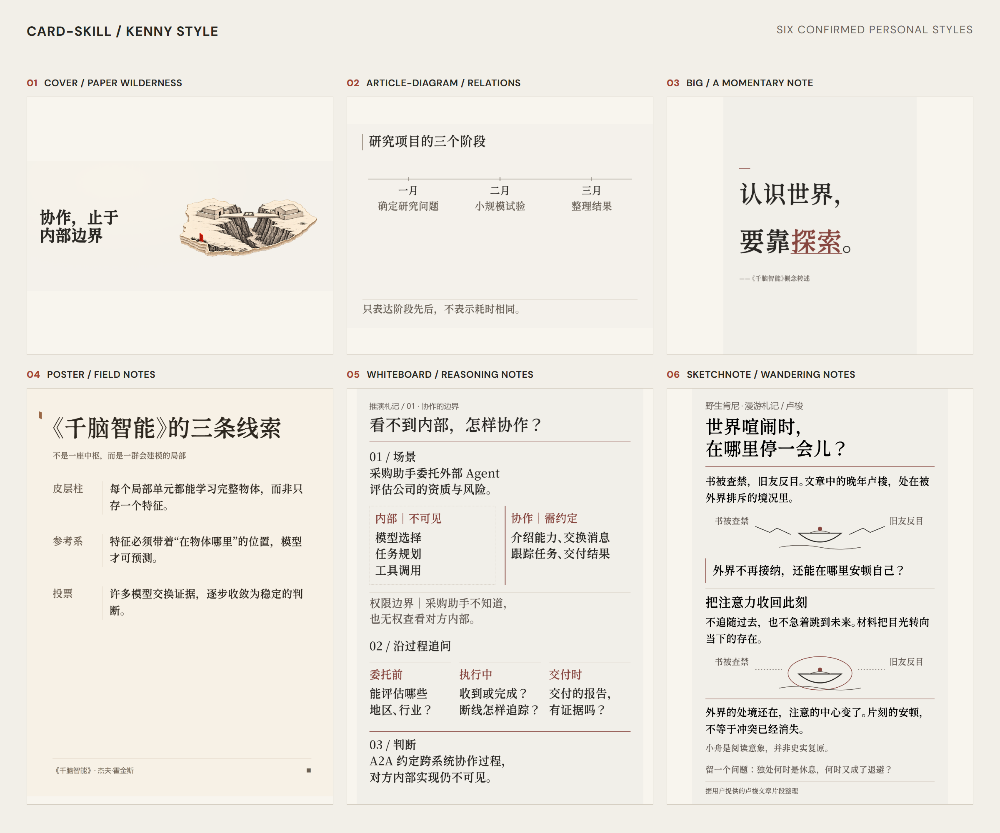
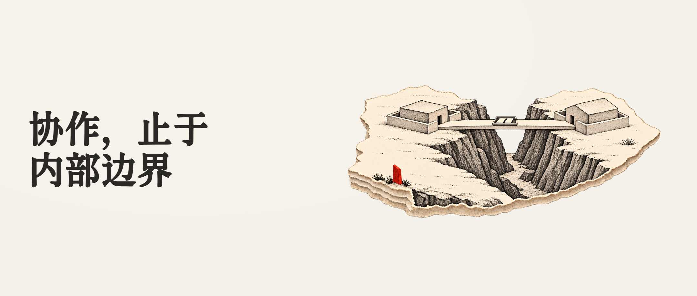
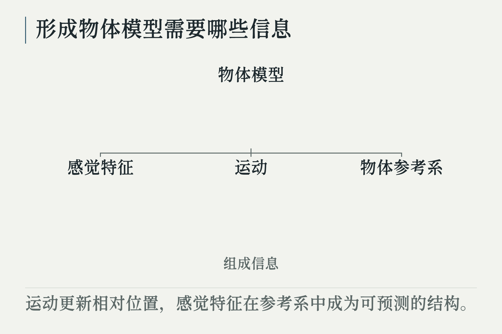
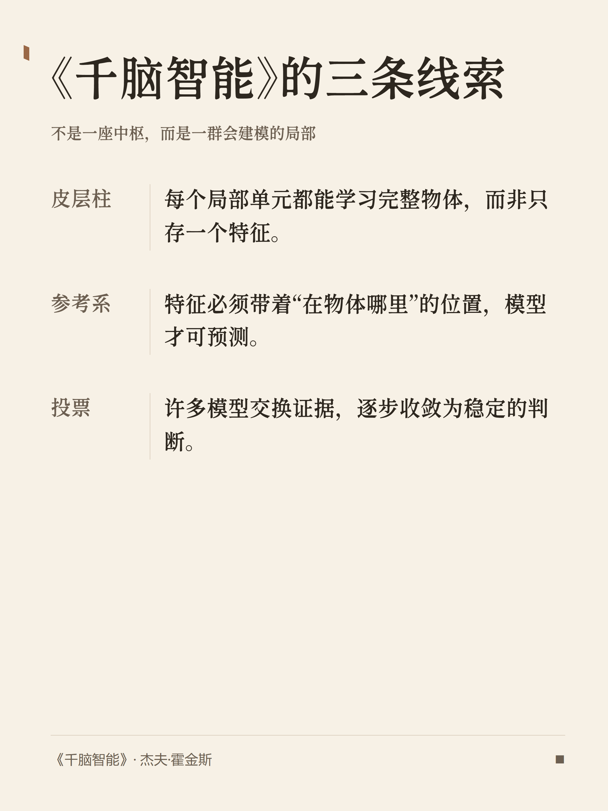
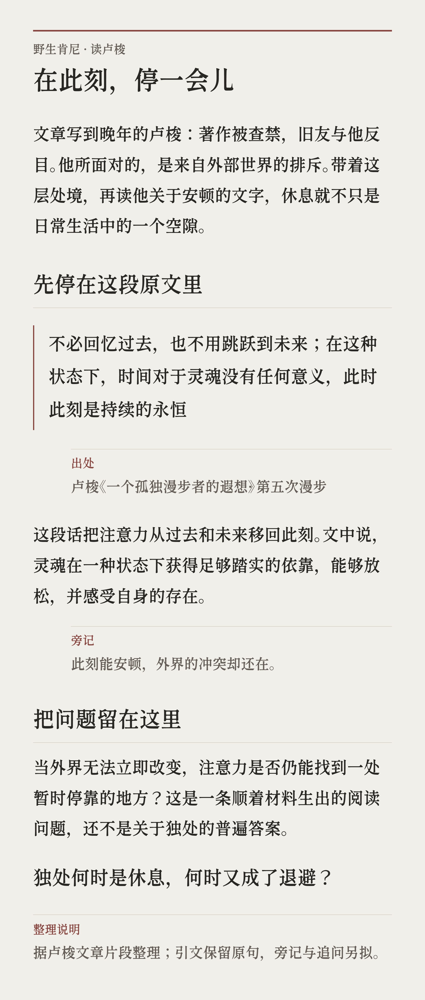
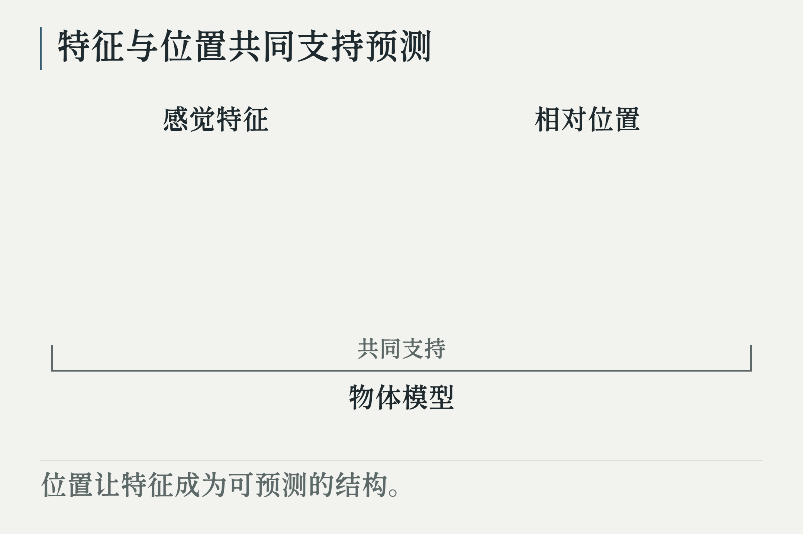
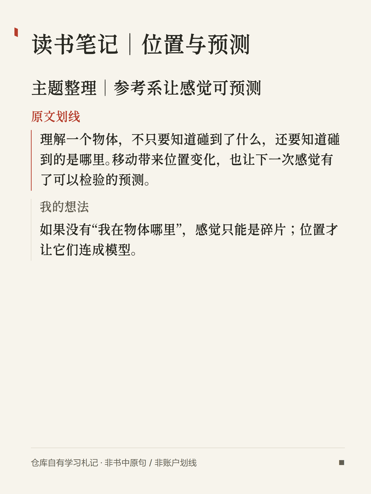
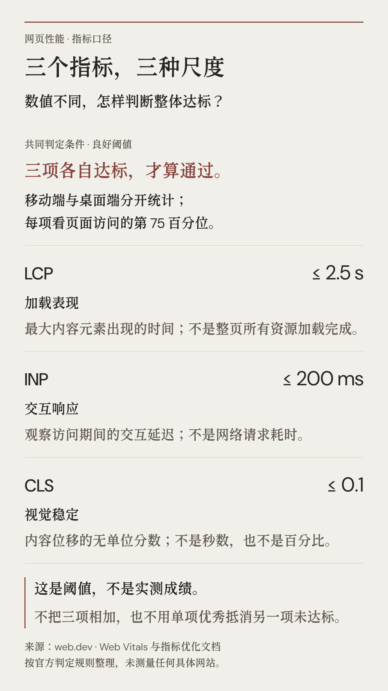
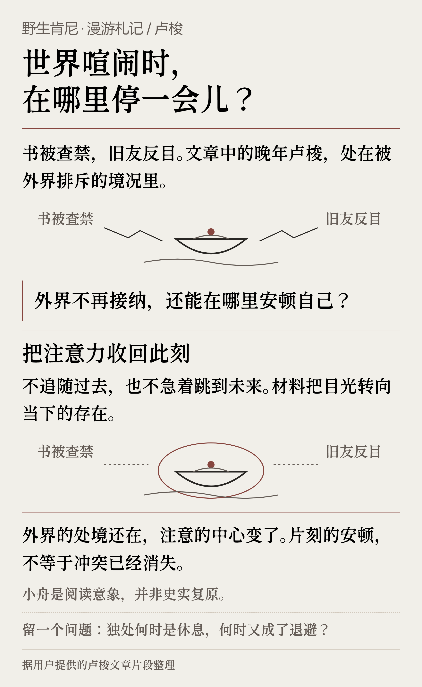
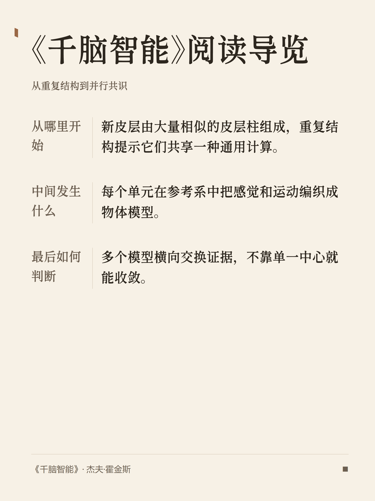

<p align="center"></p>

<h1 align="center">card-skill</h1>

<p align="center"><strong>把文章、观点和技术决策，做成可以直接发布的视觉卡片。</strong></p>

<p align="center">
  <a href="README.md">English</a> ·
  <a href="#它是什么">它是什么</a> ·
  <a href="#如何安装">安装</a> ·
  <a href="#快速示例">示例</a> ·
  <a href="#支持的格式">选格式</a> ·
  <a href="#faq">FAQ</a> ·
  <a href="#完整样张">样张</a>
</p>

## 它是什么

**card-skill** 是专为 coding agent（Claude Code、Codex、OpenCode、Pi 等）打造的视觉卡片生成 skill。输入文章、笔记、观点或技术决策，它能自动生成排版工整、可直接发布的 PNG 卡片。

与普通 AI 生图（容易生成难以预测的插画）不同，card-skill 专注于**信息层级、文字排版与结构化推演**。所有卡片均通过本地无头浏览器确定性渲染，并在导出前执行自动质量检查，呈现统一的纸质质感（**Kenny Style**）。

### 核心场景
- **编辑封面：** 公众号头图、博客封面与带有隐喻的氛围图。
- **正文解释图与白板：** 把复杂论证、因果链条和技术权衡压制成结构清晰的卡片。
- **社媒系列卡片：** 将长观点拆解为适合小红书或社交平台的连贯多卡或长阅读卡。

*(它不是 UI 界面设计器、图表绘制库、网页生成器或通用修图工具。)*

## 适合什么，不适合什么

| 适合 | 不适合 |
|---|---|
| 公众号头图、博客封面、正文氛围配图 | 网站落地页、App / 组件 UI 设计 |
| 小红书 / 社媒观点卡片与多卡轮播 | Figma 原型、Logo / VI 品牌系统 |
| 论证白板、因果链推演、技术决策权衡 | 图表库式数据绘图（如 ECharts 折线/柱状图） |
| 正文解释图：公式卡、关系图、流程图、边界模型 | 通用照片修图、图片格式转换 |
| 微信读书划线整理、个人阅读月报（需明确授权） | 自动静默扫描整个阅读账号正文 |
| 批量生成具备裁切/溢出自动质检的高清 PNG | 一次性聊天草图、无质检要求的涂鸦 |

## 30 秒看懂它能做什么

同一套视觉语法，可以自然适配不同的发布任务：封面负责营造情绪与张力，正文卡片负责讲透核心关系，白板负责推演技术权衡。



<sub>一套视觉语法，三种发布任务：观点拆解为社媒 Poster，核心张力提炼为编辑封面，推理链展开为推演白板。</sub>

## 支持的格式

你无需死记 mode 名称——只需用自然语言描述你的发布需求，agent 会自动选择最合适的模式。

| 发布目标 | Mode | 类型 | 画面呈现效果 | 详细文档 |
|---|---|---|---|---|
| 公众号或博客封面 | `editorial-image` | Stable | 情绪、张力与视觉隐喻（不是要点摘要列表） | [文档](references/mode-editorial-image.md) |
| 正文解释图 | `article-diagram` | Stable | 公式卡、关系图、流程图、边界模型 | [文档](references/mode-article-diagram.md) |
| 社媒系列卡片 | `poster` | Stable | 适合小红书/社媒的多卡观点拆解 | [文档](references/mode-poster.md) |
| 技术决策与系统推演 | `whiteboard` | Stable | 问题、约束、可选路径与最终取舍 | [文档](references/mode-whiteboard.md) |
| 长文阅读卡 | `long` | Stable | 沉浸式排版的长篇阅读卡片 | [文档](references/mode-long.md) |
| 单句金句与宣言 | `big` | Stable | 极简高冲击力的大字宣言卡 | [文档](references/mode-big.md) |
| 高密度数据与对比 | `infograph` | Studio | 高信息密度的数据比较与结构展示 | [文档](references/mode-infograph.md) |
| 叙事与冲突转折 | `comic` | Studio | 步骤化叙事、前后转折与故事情境 | [文档](references/mode-comic.md) |
| 个人随笔与反思 | `sketchnote` | Studio | 温暖亲切的手记风格视觉笔记 | [文档](references/mode-sketchnote.md) |

> **Stable 与 Studio 的区别：**
> - **Stable 模式：** 使用内置确定性模板，渲染快、排版稳定，适合批量生产。
> - **Studio 模式：** 支持定制 HTML/CSS 构图，适合表达复杂叙事与深度隐喻。

## 如何安装

请安装**完整功能包**（包含渲染脚本、模板、字体和质检器）。请勿只安装仓库根目录的 `SKILL.md`，否则会缺少运行时导致无法生成图片。

### Claude Code / Codex（推荐）

```bash
# Claude Code
claude plugin marketplace add KKenny0/card-skill
claude plugin install card-skill@card-skill

# Codex
codex plugin marketplace add KKenny0/card-skill
codex plugin add card-skill@card-skill
```

首次生成图片时，agent 会在已安装的 skill 目录下自动执行一次 `node scripts/setup-runtime.mjs`，安装锁定的 npm 依赖与 Playwright Chromium；后续调用直接复用该运行时。

### 其他 agent 或临时体验

完整安装（将 `-a codex` 替换为你的 agent 标识）：

```bash
npx skills add KKenny0/card-skill/plugins/card-skill/skills/card-skill -a codex -g -y
cd ~/.agents/skills/card-skill
npm install
npx playwright install chromium
```

临时体验（无需常驻安装）：

```bash
npx skills use KKenny0/card-skill/plugins/card-skill/skills/card-skill --skill card-skill
```

**环境要求：** Node.js 22+、npm 与 Playwright Chromium。字体随包自带，截图全程离线运行。

<details>
<summary>可选：在 Codex 桌面会话中先预览方向</summary>

在支持交互式卡片的 Codex 桌面会话中，可以明确要求先出方案再制图：

```text
先给我 3 个公众号头图方向，展示每个方向的视觉隐喻、比例、适用理由和风险；我选定后再渲染 PNG。
```

</details>

## 快速示例

无需斜杠命令，使用自然语言即可（中英文均可）：

**公众号头图**
```text
把下面这篇文章做成一张公众号头图。不要复述摘要，提炼文章的核心张力，用安静的纸张质感呈现，完成后检查裁切、换行和可读性：

[粘贴文章正文或 URL]
```

**正文解释图 / 公式卡**
```text
把这篇文章里值得压缩的章节做成正文解释图。每张只保留核心关系公式和一句判断，跳过纯铺垫和情绪段落。
```

**社媒系列卡片（小红书等）**
```text
把下面这段观点拆成一组社媒卡片。第一张是总判断，后面每张只讲一个支撑点，风格克制，不要营销腔。
```

**技术决策白板**
```text
把这个技术决策画成白板卡：写清问题、约束、可选路径和最终取舍，让没参与讨论的人也能看懂。
```

**微信读书划线 / 阅读月报**
```text
把我在《千脑智能》里的个人划线和想法做成一组卡片。原文不要改写，把我的想法放在对应划线下面，并标明来源。

把我这个月的微信读书数据做成阅读月报。只使用真实返回的时长、天数、读完数量和偏好；缺少的模块直接省略，不要补造洞察。
```

## 核心特性

- **标志材质（Kenny Style）：** 温暖质感的纸面底色（Quiet Paper）、严谨的字系层级、克制的间距与精致的几何圆角。
- **自动质量门禁：** 截图前后自动校验文字溢出、尴尬换行、元素截断、图片失效与对比度不足。
- **纯本地与隐私保护：** 渲染与检查全部在本地通过 Playwright Chromium 完成，文章与图片绝不上传任何外部服务器。
- **Retina 高清导出：** 默认导出 2 倍高分 PNG（标准画布宽度约 2160px），满足清晰视网膜屏幕与平台发布需求。
- **调色不跑版：** 提供 `reflective`、`sharp`、`warm`、`technical` 4 种色调，只改变配色，排版间距与结构纹丝不动。
- **按内容自适应卡数：** 根据实际材料信息量自动生成 1–4 张卡片，绝不生拉硬拽填充无用废话。
- **默认无水印与署名：** 只有在输入中明确指定时才会显示作者名、Logo 或来源；未提供时界面保持纯净。

## 开源工具自适应 Showcase

card-skill 会根据输入材料的属性自适应卡片数量与结构。例如：开源工具发布会生成包含 4 项证据的完整序列，而 CLI 工具则精简为 3 张任务流卡片：

<table>
<tr>
<td width="25%"></td>
<td width="25%"></td>
<td width="25%"></td>
<td width="25%"></td>
</tr>
</table>
<table>
<tr>
<td width="33%"></td>
<td width="33%"></td>
<td width="33%"></td>
</tr>
</table>

<sub>以上展示数据均为虚构。详见 <a href="https://github.com/KKenny0/card-skill/tree/main/showcases/open-source-tool">可复现 showcase 目录</a>。</sub>

## 工作流程

与依赖单一 prompt 的生成式生图不同，card-skill 采用结构化、确定性的制图流程：

1. **解析内容：** 提取文本、笔记、URL 或数据中的核心论点与结构关系。
2. **匹配版式：** 匹配最适合该内容的视觉模式（如技术决策匹配白板、长文匹配编辑封面）。
3. **本地渲染：** 生成语义化 HTML/CSS，并通过 Playwright Chromium 高清渲染。
4. **质量质检：** 自动检查文本溢出、裁切问题与可读性缺陷。
5. **交付输出：** 将通过质检的高清 PNG 直接保存至系统的 `~/Downloads/` 目录。

<details>
<summary>高级用法：命令行、更新与压缩优化</summary>

### 独立命令行

你也可以直接使用命令行渲染结构化输入：

```bash
node scripts/card.js --input /path/to/input.json --output ~/Downloads/card.png
```

### 图片体积优化

默认导出的 PNG 为无损格式。如需进一步压缩体积，可使用 `pngquant`：

```bash
pngquant --quality=80-95 --force --output card.png card.png
```

### 检查更新与隐私

CLI 每天最多检查一次 GitHub Release。更新绝不会在正在制图时切换版本。如需关闭检查：

```bash
export CARD_SKILL_DISABLE_UPDATE_CHECK=1
```

如需保留检查但禁止自动升级：

```bash
export CARD_SKILL_DISABLE_AUTO_UPDATE=1
```

</details>

## FAQ

### card-skill 是什么？
它是专为 coding agent 打造的本地内容制图技能，能把文章、笔记和技术决策转化成经过质检的高清 PNG 卡片。

### 我需要会设计或手写 HTML 吗？
不需要。直接用日常文字提出需求，agent 会自动选择模式、整理数据并完成渲染。

### 支持哪些 agent？
支持 Claude Code、Codex、OpenCode、Pi 等任何支持 agent skill 的环境。Claude Code 与 Codex 推荐直接通过插件市场安装。

### 会自动添加作者署名或水印吗？
不会。只有当你在输入中明确提供作者名、Logo 或来源时才会渲染，否则对应区域保持隐藏。

### 和直接让 AI 画一张图有什么不同？
card-skill 基于确定性的 HTML/CSS 模板、文字排版规则、浏览器真实渲染与严格质检，输出的是排版工整、可直接发布的卡片，而不是随机不可控的 AI 绘画。

### 会上传我的文章或数据吗？
不会。所有渲染与质检全部在你的本地设备运行。版本检查仅访问公开的 GitHub Release。

## 完整样张

<details>
<summary>展开样张画廊（12 组）</summary>

<p><sub>样张取材自杰夫·霍金斯的《千脑智能》（A Thousand Brains）。</sub></p>

<table>
<tr>
<td width="50%"><br><strong>editorial-image</strong> · 千个模型，一个判断</td>
<td width="50%"><br><strong>article-diagram</strong> · 感觉、运动与参考系</td>
</tr>
<tr>
<td><br><strong>big</strong> · 探索世界</td>
<td><br><strong>poster</strong> · 三条线索</td>
</tr>
<tr>
<td><br><strong>long</strong> · 智能是建模</td>
<td><br><strong>whiteboard</strong> · 认识一个杯子</td>
</tr>
<tr>
<td><br><strong>article-diagram</strong> · 参考系边界模型</td>
<td><br><strong>poster</strong> · 阅读笔记</td>
</tr>
<tr>
<td><br><strong>infograph</strong> · 局部模型到共同判断</td>
<td><br><strong>comic</strong> · 摸到一条边以后</td>
</tr>
<tr>
<td><br><strong>sketchnote</strong> · 感觉、定位与预测</td>
<td><br><strong>poster</strong> · 阅读导览</td>
</tr>
</table>

</details>

## 微信读书整合

card-skill 可以配合腾讯官方 [WeChatReading Skill](https://github.com/Tencent/WeChatReading) 使用，将指定书籍的划线与想法整理成卡片组，或生成个人阅读月报。

它绝不会在未获指示的情况下擅自扫描账号。腾讯 Skill 负责读取与认证，card-skill 仅在本地组织数据并渲染出图。

```bash
npx skills add Tencent/WeChatReading -g
```

## 作者与社区

**card-skill** 由 [Kenny Wu (@KKenny0)](https://github.com/KKenny0) 创建并维护。

如果 card-skill 帮到了你的内容创作，欢迎在 [GitHub Issues](https://github.com/KKenny0/card-skill/issues) 分享你的作品或反馈。你也可以通过 [Support](https://kkenny0.github.io/support/) 支持本项目的持续维护。

## 致谢

card-skill 受到以下项目的启发：
- [awesome-design-md](https://github.com/VoltAgent/awesome-design-md) by VoltAgent — 品牌设计参考库
- [ljg-card](https://github.com/lijigang/ljg-skills/tree/master/skills/ljg-card) by lijigang — 内容制图与品味规则
- [Kami](https://github.com/tw93/kami) by tw93 — Quiet Paper 在纸感、墨色与节奏上的设计约束
- [The New Yorker 封面设计实践](https://www.newyorker.com/culture/video-dept/the-art-of-the-new-yorker-cover) 与 [GOV.UK 图片指引](https://guidance.publishing.service.gov.uk/formatting-content/images/) — 编辑配图的克制原则

## 开源许可

[MIT](LICENSE) © 2026 Kenny Wu
